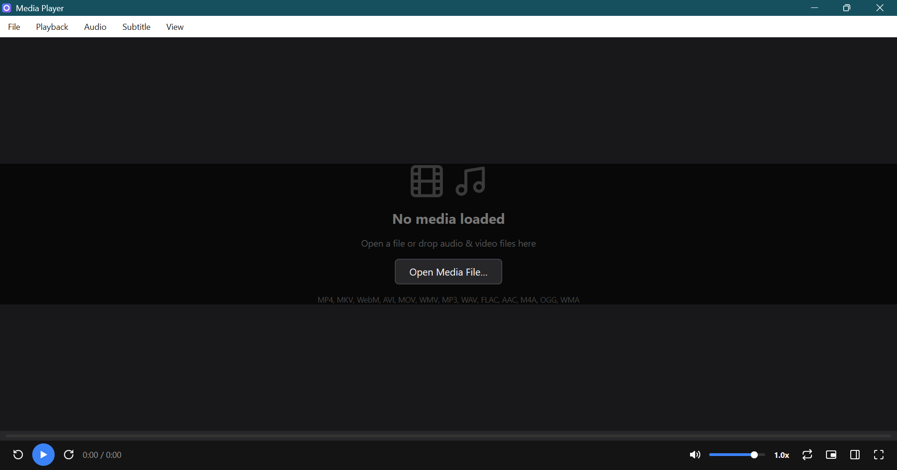

# Media Player

A high-performance, lightweight video and audio player built with [MyGo](https://github.com/egoist/mygo) native UI in pure Go. Engineered for responsive media playback, extensive format compatibility, zero-dependency standalone execution on Windows, and hardware-accelerated HD/4K playback.

This Project is also Listed on

[](https://awesomemygo.dev/apps/video-player)



## Key Features

### 1. Zero-Dependency Standalone Playback (No FFmpeg Required)
- **Built-in Windows Media Engine**: Uses native Windows subsystem automation (`WMPlayer.OCX`) for audio playback and metadata probing out of the box with zero external binaries installed.
- **Dynamic Audio Spectrum Visualizer**: Displays a real-time animated harmonic frequency waveform and track metadata card during audio playback.
- **Optional FFmpeg Hardware Acceleration**: If `ffmpeg` or `ffplay` is detected in `PATH`, the player automatically leverages them with GPU hardware acceleration (`-hwaccel auto`) and multithreaded decoding (`-threads 0`).

### 2. Comprehensive Format Support
- **Audio Formats**: MP3, WAV, FLAC, AAC, M4A, OGG, WMA, AIFF, ALAC, MIDI, Opus.
- **Video Formats**: MP4, MKV, WebM, AVI, MOV, WMV, FLV, M4V, TS.
- **Subtitle Formats**: SubRip (`.srt`) and WebVTT (`.vtt`), including embedded subtitle streams and external sidecar files.

### 3. Native Windows Win32 File Dialogs
- Direct integration with Win32 `comdlg32.dll` (`GetOpenFileNameW`) using pure Go syscalls.
- **Instant Response**: Opens the standard modern Windows file picker (Quick Access, Search, Preview pane) with **0ms process startup overhead**, replacing slow PowerShell/forms wrappers.
- Dedicated categorized filters for Media Files, Audio Files, Video Files, and Subtitle Files.

### 4. HD & 4K Smooth Playback Optimization
- **Instant Seek during Playback**: Seeking or forwarding when playing immediately redirects the playback pipeline to the target timestamp with zero latency.
- **Zero-Allocation Double-Buffering**: Video frames alternate across pre-allocated buffers (`bufio.NewReaderSize`), eliminating over 200 MB/s of heap allocations and preventing Go garbage collection stutters.
- **Proportional Viewport Scaling**: Ultra-high-resolution files (such as 4K 3840×2160) scale smoothly to a 1080p viewport while preserving the exact aspect ratio, preventing pipe saturation.

### 5. Responsive Subtitle System
- **Always-Visible Multi-Track Selection**: Subtitle tracks are organized in a dedicated card showing active status, track name, and cue count. Never truncates multi-language files.
- **Customizable Appearance & Position**:
  - **Font Size**: Incremental adjustments (`A-` / `A+`) from 12 pt to 40 pt, with quick presets (`14`, `18`, `24`, `30` pt).
  - **Vertical Position**: Adjust vertical placement (`▲ Move Up` / `▼ Move Down`) from 8 px to 350 px from the bottom, with quick presets (`Bottom`, `Lower-Mid`, `Center`).
  - **One-Click Reset**: Quickly revert to standard layout defaults.
- **Interactive Cue Seeking**: Scrollable list of subtitle cues with timestamps—clicking any cue immediately seeks the video to that moment.

### 6. Modern Desktop UI
- Clean VLC/mpv-inspired interface with Dark and Light theme toggle.
- Interactive scrub bar with hover thumb and buffered progress fill.
- Right-side slide-out panel with three tabs: **Playlist**, **Subtitles**, and **Drop Zone**.
- Fullscreen mode, Picture-in-Picture (PiP), and variable playback speed (`0.5x` to `2.0x`).
- Native drag-and-drop support on both the video viewport and side panel drop zone.

---

## Keyboard Shortcuts

| Shortcut | Action |
| :--- | :--- |
| <kbd>Space</kbd> / <kbd>K</kbd> | Play / Pause |
| <kbd>←</kbd> | Step backward 5 seconds |
| <kbd>→</kbd> | Step forward 5 seconds |
| <kbd>Ctrl</kbd> + <kbd>←</kbd> | Previous playlist track |
| <kbd>Ctrl</kbd> + <kbd>→</kbd> | Next playlist track |
| <kbd>↑</kbd> | Increase volume (+5%) |
| <kbd>↓</kbd> | Decrease volume (-5%) |
| <kbd>M</kbd> | Mute / Unmute audio |
| <kbd>F</kbd> / <kbd>F11</kbd> | Toggle Fullscreen |
| <kbd>C</kbd> | Toggle Subtitles On / Off |
| <kbd>Ctrl</kbd> + <kbd>=</kbd> / <kbd>+</kbd> | Increase subtitle font size |
| <kbd>Ctrl</kbd> + <kbd>-</kbd> | Decrease subtitle font size |
| <kbd>Alt</kbd> + <kbd>↑</kbd> | Move subtitles up |
| <kbd>Alt</kbd> + <kbd>↓</kbd> | Move subtitles down |
| <kbd>Ctrl</kbd> + <kbd>O</kbd> | Open Media File dialog |
| <kbd>Ctrl</kbd> + <kbd>Shift</kbd> + <kbd>A</kbd> | Open Audio File dialog |
| <kbd>Ctrl</kbd> + <kbd>Shift</kbd> + <kbd>V</kbd> | Open Video File dialog |
| <kbd>Ctrl</kbd> + <kbd>P</kbd> | Toggle Side Panel |

---

## Architecture & Codebase Structure

```
├── main.go            # Application state, UI components, controls toolbar, side panels, and menus
├── engine.go          # PlaybackEngine (FFmpeg streaming, native Windows audio, waveform visualizer)
├── dialog_windows.go  # Native Windows Win32 GetOpenFileNameW direct integration
├── dialog_other.go    # Cross-platform fallback stub for file dialogs
├── subtitles.go       # High-performance SRT/VTT parser and cue timeline lookup
├── main_test.go       # Comprehensive test suites for UI views, controls, and parsing
├── go.mod / go.sum    # Dependency management (pure Go, MyGo v0.8.3)
└── mygo.json          # Desktop application manifest and build metadata
```

---

## Build & Requirements

### Pure Go (`CGO_ENABLED=0`)
- **No C compiler required**: Builds cleanly without GCC, MinGW, or Clang.
- Pure Go windowing and rendering via `github.com/egoist/mygo`.

### Prerequisites
- [Go 1.24+](https://go.dev/dl/) installed.
- Windows 10/11 (for native Win32 dialogs and built-in Windows Media automation).
- *(Optional)* [FFmpeg](https://ffmpeg.org/) in `PATH` for full hardware-accelerated video frame extraction.

---

## How to Run

### Development Mode (with Live Reload)
```powershell
go tool mygo dev
```
*Note: Make sure to type `tool` (not `too`). MyGo will watch for file changes, rebuild into `.mygo/dev/`, and reload automatically.*

If your terminal shell does not alias Go tools directly:
```powershell
go run github.com/egoist/mygo/cmd/mygo dev
```

### Direct Run
```powershell
go run .
```

---

## How to Build

### Production GUI Binary (No Console Window)
```powershell
$env:CGO_ENABLED="0"; go build -ldflags "-H windowsgui" -o video.exe .
```

### Build with MyGo Toolchain
```powershell
go tool mygo build
```

---

## Testing & Quality Assurance

Run the automated test suite:
```powershell
$env:CGO_ENABLED="0"; go test -v ./...
```

Run static analysis and UI lifetime verification:
```powershell
go vet ./...
go tool mygo vet .
```

---

## License
MIT License. Built with [MyGo](https://github.com/egoist/mygo).
